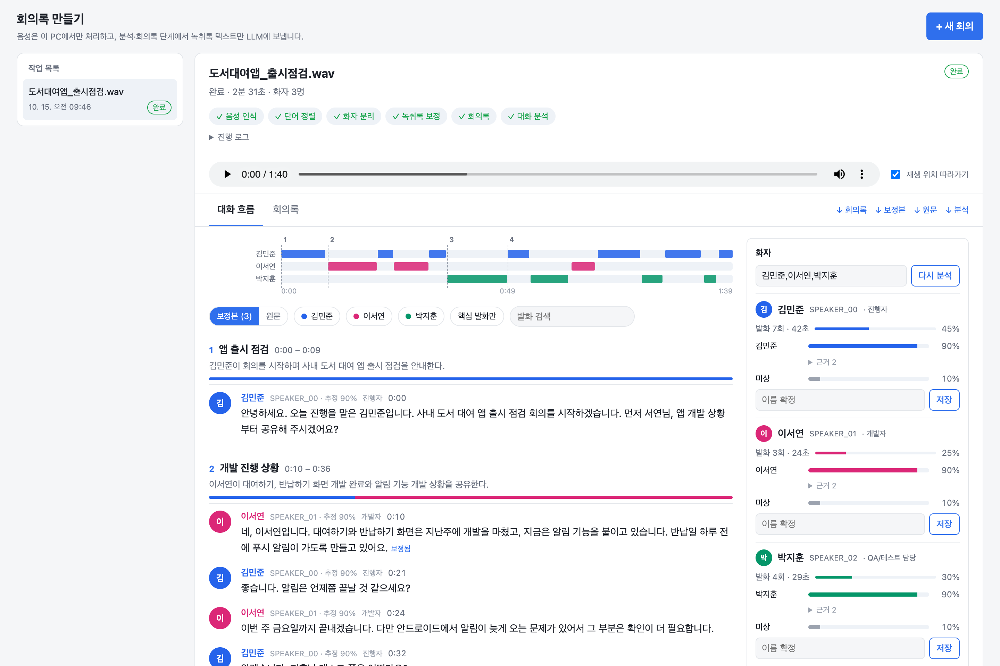
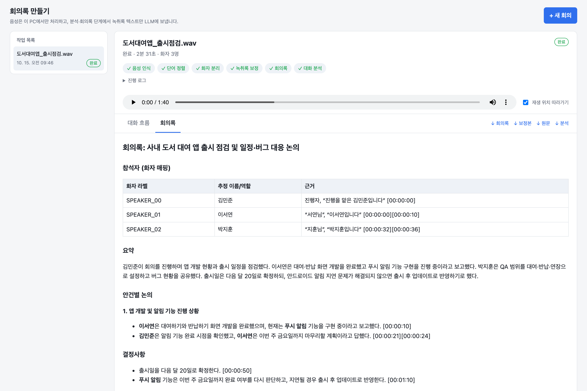

# meeting-minutes

Turn any recording into a **speaker-attributed transcript** and a **structured document** (meeting minutes, interview notes, call summary, lecture notes...). [한국어](README.md)

- Speech recognition, word alignment and speaker diarization run on your machine (WhisperX + pyannote).
- Minutes, transcript correction and conversation analysis use an LLM of your choice: Claude, OpenAI, Gemini, OpenRouter, or any OpenAI-compatible server (Ollama, vLLM, a company gateway). With Ollama nothing leaves your machine.
- Recording-type profiles (meeting, interview, call, lecture, podcast, voice memo, general) each have their own document template; add your own as a TOML file.
- The local part is also a **skill and MCP server**: attach it to Claude Code or Codex and the agent transcribes and writes the document itself. Or hand only the writing to a local `claude` / `codex` CLI (no API key).
- A local web UI shows the conversation by topic, a per-speaker timeline, key turns and the minutes. Click a turn to play the original audio from there.

Prompts and the UI are in Korean and the default language is `ko`; other languages work with `--language`, but the minutes template will still be Korean.

```
audio ─▶ faster-whisper (ASR, loop and skipped-speech repair) ─▶ wav2vec2 alignment ─▶ pyannote diarization
      ─▶ speaker turns transcript.json
      ─▶ LLM: transcript correction ─▶ minutes.md + analysis.json
```

## Screenshots

A made-up three-person meeting (1:40), synthesized with macOS TTS and run through the real pipeline; 2:31 end to end on an M4 Pro CPU.




## Install

Requires Python 3.12, [uv](https://docs.astral.sh/uv/) and ffmpeg.

```bash
brew install ffmpeg            # Ubuntu: sudo apt install ffmpeg
git clone https://github.com/seongyeon1/meeting-minutes.git
cd meeting-minutes
uv sync
```

Accept the terms of [pyannote/speaker-diarization-community-1](https://huggingface.co/pyannote/speaker-diarization-community-1), then `hf auth login` or set `HF_TOKEN`.

## LLMs

Pass an alias or `provider:model` to `--llm`:

| Value | Target | Key |
|---|---|---|
| `claude` (default) | `anthropic:claude-opus-5-5` | `ANTHROPIC_API_KEY` |
| `gpt` | `openai:gpt-5.2` | `OPENAI_API_KEY` |
| `openai:<model>` | OpenAI (`OPENAI_BASE_URL` for Azure or a proxy) | `OPENAI_API_KEY` |
| `gemini:<model>` | Gemini's OpenAI-compatible endpoint | `GEMINI_API_KEY` |
| `openrouter:<model>` | OpenRouter | `OPENROUTER_API_KEY` |
| `ollama:<model>` | local Ollama (`OLLAMA_BASE_URL`) | none |
| `compat:<model>` | any OpenAI-compatible server (`LLM_BASE_URL`) | `LLM_API_KEY` (optional) |

Keys are read from the environment or `--env-file .env` (see [.env.example](.env.example)). To name your own models or change the defaults, create `llm.toml` from [llm.example.toml](llm.example.toml).

Correction and speaker-name inference need a model that follows "don't guess" rules; large reasoning models (Claude, GPT-5 class) did best. A split such as a small model for minutes and a large one for analysis (`default` / `analysis_default`) works well.

## Use

```bash
uv run meeting-minutes-web --env-file .env      # http://127.0.0.1:8765
uv run meeting-minutes meeting.m4a --speakers 3 --names "Alice,Bob" --correct --analyze
uv run meeting-minutes meeting.m4a --llm ollama:qwen3:14b --analysis-llm ollama:qwen3:14b
```

> [!WARNING]
> The web server has no authentication. Keep it on `127.0.0.1`. Changing requests (agent install, profile save, job delete) from another origin are refused.

The web UI controls the rest too:

- **Processing mode** (new recording): "Transcript only" runs ASR, alignment and diarization locally and never calls an LLM. Fill the document later with a model, or paste Markdown an agent wrote into "Save as document".
- **Connect agents** (top bar): shows whether the Claude Code / Codex CLI, the MCP registration and the skill are in place, and connects with a button after showing exactly what will change in your global config. The agent then shares this UI's job folder (`--out-dir`), so jobs it creates show up here and update live. A copyable MCP JSON is there for other agents.
- **Recording types** (top bar): browse, add, clone, edit and delete profiles (saved to `~/.config/voicekit/profiles/<id>.toml`).
- **Record in the browser** (new recording): "Record now" captures from the microphone (level meter, preview) and uses the result as the upload. Needs the browser's mic permission; the audio stays on this PC.
- **Remembered terms** (top bar "기억한 용어", "수정" on each turn): fix a misrecognized word in the transcript and the (wrong, right) pair is remembered per recording type ("공통" applies to all). After the same fix is confirmed twice, or when you pin it, the right spelling goes into Whisper's initial prompt and the correction and document prompts, and the wrong spelling is replaced as a whole word (a trailing Korean particle is kept) in new transcripts. One-character spellings are replaced only when pinned. Local only, no LLM; opt out per recording with "기억한 용어 사용", files in `~/.config/voicekit/memory/<type>.json` (`VOICEKIT_MEMORY_DIR`), `VOICEKIT_MEMORY=off` ignores it all. Your edits are logged in the job's `edits.json`, automatic replacements in `memory_applied.json`.
- **Run an agent on a job** (the "에이전트" tab of a job): pick Claude Code or Codex on this PC and give it a preset (write the document, confirm speaker names, decisions and action items only) or your own instruction. It works in several steps and the tools it calls show up live. It is a chat: keep asking for changes ("expand the second topic") and earlier turns are kept in the job folder until you press "새 대화". It may use the voicekit tools only: no shell, files or web, one job only (no other recordings, no new transcription, no other models), one run at a time, cancellable. No global connection is needed.
- **Delete job** removes the job and its folder.

## Profiles, agents, MCP

```bash
uv run meeting-minutes talk.m4a --profile lecture --no-diarize     # one speaker: skips the slowest stage
uv run meeting-minutes call.wav --profile call --llm claude-code   # a local Claude Code CLI writes the summary
uv sync --extra mcp
uv run voicekit install claude --apply     # skill + MCP server (dry run without --apply); also: codex
uv run voicekit transcribe meeting.m4a --profile interview         # CLI route, prints job dir (no LLM)
uv run voicekit prompt <job>               # prompt for an agent to follow; then: voicekit save-document <job> < doc.md
```

Profiles live in `voicekit/profiles/*.toml`; drop your own in `./profiles/`, `~/.config/voicekit/profiles/` or `$VOICEKIT_PROFILES`.
MCP tools: `list_profiles`, `transcribe_audio`, `wait_for_job`, `job_status`, `list_jobs`, `read_transcript`, `get_document_prompt`,
`save_document`, `generate_document`, `set_speaker_names`. The agent writes the document from `get_document_prompt` with its own model.
Agent CLIs run headless in an empty temp dir with tools disabled. Share jobs with the web UI via `--out-dir ~/.voicekit/jobs`.

## Privacy

Audio never leaves the machine. The transcript **text** is sent to the LLM provider you pick (with `claude-code` / `codex`, to whatever that CLI is logged in to; with MCP, to the attached agent's model). Use `ollama:` or `--no-summary` for sensitive meetings.

## License

[MIT](LICENSE). Models keep their own licenses (WhisperX BSD-2-Clause, faster-whisper MIT, pyannote community-1 CC-BY-4.0 with gated access, wav2vec2-large-xlsr-korean Apache-2.0).
