# meeting-minutes

녹음 파일 하나로 **화자별 녹취록**과 **정리 문서**(회의록, 인터뷰 정리, 상담 요약, 강의 노트 등)를 만드는 로컬 도구입니다. [English](README.en.md)

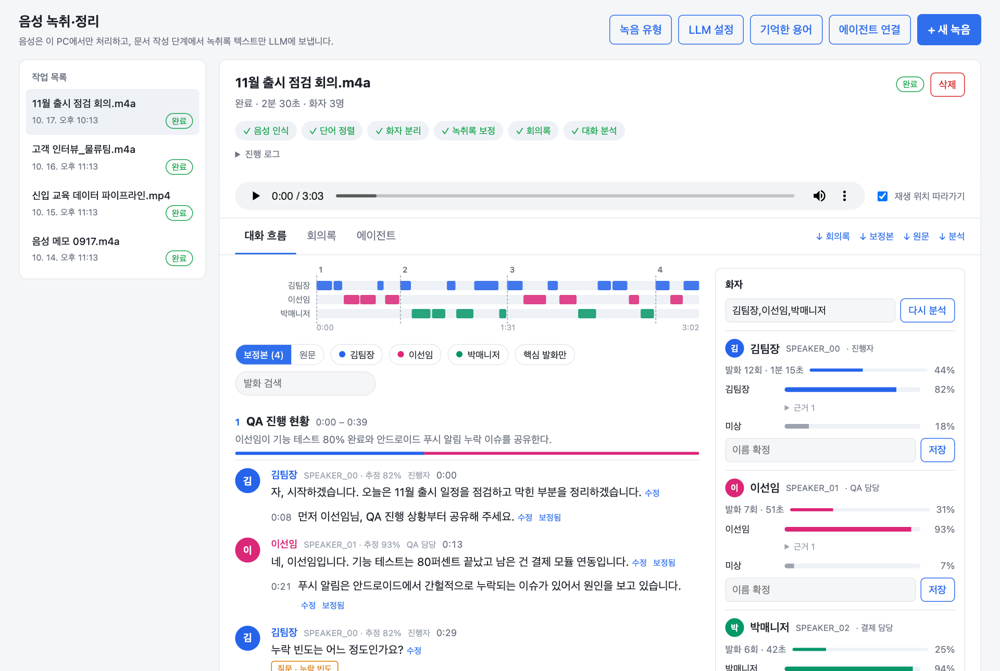

## 한눈에 보기

- **음성은 내 PC 안에서만 처리합니다.** 음성 인식, 단어 정렬, 화자 분리는 로컬에서 돌고 LLM을 쓰지 않습니다 (WhisperX + pyannote).
- **문서 작성에만 LLM을 씁니다.** 회의록, 녹취록 보정, 대화 분석에 Claude, OpenAI, Gemini, OpenRouter, Ollama·vLLM·사내 게이트웨이 같은 OpenAI 호환 서버를 연결합니다. Ollama를 쓰면 외부로 나가는 데이터가 없습니다.
- **모델과 API 키는 화면에서 설정합니다.** 환경변수나 파일 편집 없이 「LLM 설정」에서 추가하고 연결을 테스트합니다.
- **여러 종류의 녹음을 다룹니다.** 회의, 인터뷰, 상담, 강의, 팟캐스트, 음성 메모 유형마다 문서 양식이 다르고 직접 추가할 수 있습니다.
- **쓸수록 나아집니다.** 발화에서 틀린 단어를 고치면 유형별로 기억해 다음 녹음의 인식 힌트와 자동 바로잡기에 씁니다 (LLM 없이 로컬).
- **에이전트와 함께 씁니다.** 로컬 처리 부분이 스킬과 MCP 서버라서 Claude Code, Codex에 붙이면 에이전트가 직접 녹취하고 문서를 씁니다. 화면에서 에이전트와 대화하며 문서를 고치게 할 수도 있습니다.

```
audio ─▶ faster-whisper (ASR, 반복·누락 구간 복구) ─▶ wav2vec2 단어 정렬 ─▶ pyannote 화자 분리
      ─▶ 화자 턴 transcript.json
      ─▶ LLM: 녹취록 보정 ─▶ 회의록 minutes.md + 대화 분석 analysis.json
```

구조와 설계 이유는 [docs/ARCHITECTURE.md](docs/ARCHITECTURE.md)에 정리했습니다.

**목차**: [빠른 시작](#빠른-시작) · [화면 둘러보기](#화면-둘러보기) · [LLM 연결](#llm-연결) · [에이전트와 함께 쓰기](#에이전트와-함께-쓰기) · [CLI](#cli) · [녹음 유형](#녹음-유형-프로필) · [데이터가 어디로 가나요](#데이터가-어디로-가나요)

## 빠른 시작

필요한 것: Python 3.12, [uv](https://docs.astral.sh/uv/), ffmpeg

**1. 설치**

```bash
brew install ffmpeg            # Ubuntu: sudo apt install ffmpeg
git clone https://github.com/seongyeon1/meeting-minutes.git
cd meeting-minutes
uv sync
```

화자 분리 모델은 Hugging Face에서 사용 동의가 필요합니다. https://huggingface.co/pyannote/speaker-diarization-community-1 에서 동의한 뒤 `hf auth login` 하거나 `HF_TOKEN` 환경변수를 설정하세요. 모델 가중치(Whisper, wav2vec2, pyannote)는 처음 실행할 때 한 번 내려받습니다.

**2. 화면 실행**

```bash
uv run meeting-minutes-web
# http://127.0.0.1:8765
```

**3. LLM 연결** (문서를 쓸 모델이 필요합니다)

상단 「LLM 설정」에서 API 키를 넣거나 모델을 추가하고 「연결 테스트」를 누르면 끝입니다. API 키가 없어도 이 PC에 로그인된 Claude Code나 Codex CLI(`claude-code`, `codex`)를 고르면 됩니다. 자세한 내용은 [LLM 연결](#llm-연결)을 보세요.

**4. 녹음 올리기**

「+ 새 녹음」에서 파일을 올리거나 바로 녹음하면 진행 단계가 실시간으로 보입니다. 7분 회의 기준 약 8분이 걸리고 대부분이 화자 분리입니다. LLM 없이 녹취록만 만들 수도 있습니다.

## 화면 둘러보기

> 아래 `ui-*` 캡처는 지어낸 예시 회의로 구성한 화면이고, 「대화 흐름」「녹취록 보정」「회의록」 캡처는 지어낸 3인 회의 대본(1분 40초)을 macOS 음성 합성으로 만들어 실제로 돌린 결과입니다 (Apple M4 Pro CPU, 전체 2분 31초).

### 새 녹음

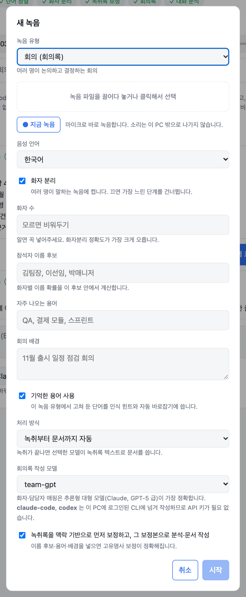

- 녹음 유형(회의, 인터뷰, 상담, 강의 등)을 고르면 문서 양식과 기본 처리 방식이 따라옵니다. 한 명이 말하는 유형은 화자 분리를 건너뛰어 훨씬 빨리 끝납니다.
- 파일을 끌어다 놓거나 「지금 녹음」으로 마이크 녹음을 시작하면 소리 크기를 보면서 녹음하고, 끝내면 미리 듣고 그대로 올릴 수 있습니다. 브라우저 마이크 권한이 필요하고 소리는 이 PC 밖으로 나가지 않습니다.
- 화자 수, 참석자 이름 후보, 자주 나오는 용어, 녹음 배경을 알려주면 정확도가 오릅니다.
- **처리 방식**에서 「녹취록만 만들기」를 고르면 LLM을 한 번도 부르지 않고 음성 인식·정렬·화자분리까지만 합니다. 문서는 나중에 모델을 골라 만들거나, 에이전트가 쓴 Markdown을 「문서로 저장」에 붙여 넣어 채웁니다.

### 대화 흐름

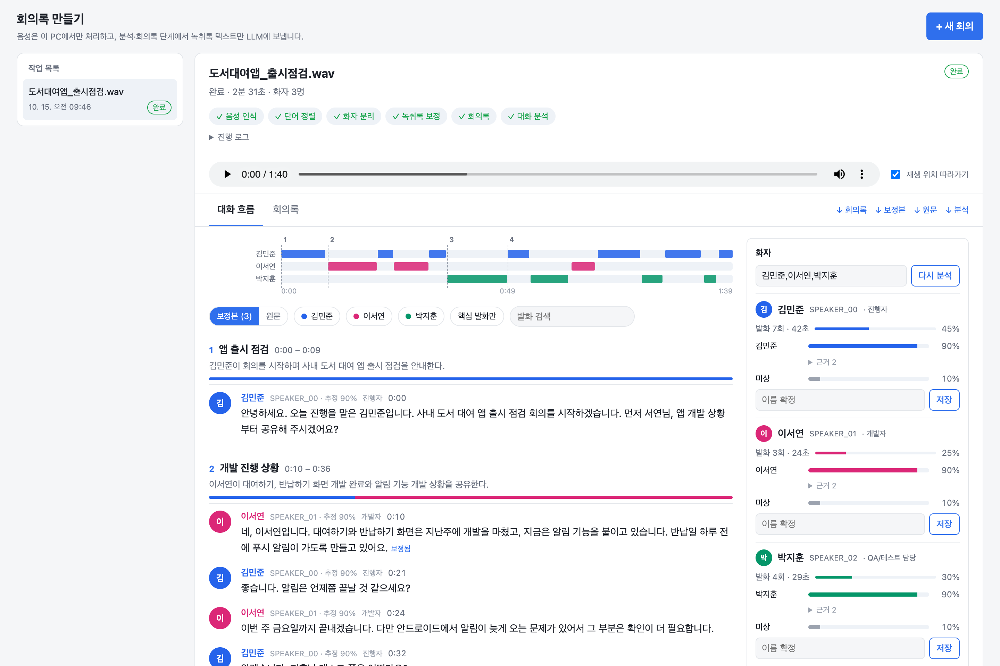

주제 구간별 대화, 화자별 타임라인, 화자·검색·핵심 발화 필터, 결정/할 일/질문/이슈 표시가 한 화면에 나옵니다. 발화를 누르면 그 시점부터 원본 음성이 재생됩니다. 화자 카드에는 발화 비중, 이름 후보별 확률과 근거 발화가 있고, 이름을 확정하면 화면 전체와 이후 문서에 반영됩니다.

### 발화 고치기와 기억한 용어

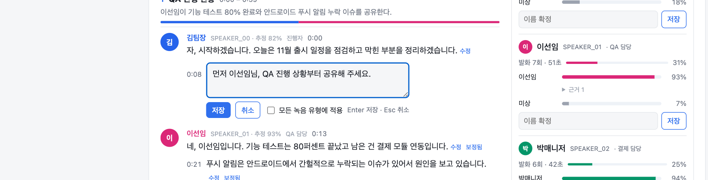

발화 옆 「수정」으로 틀린 단어를 고치면 「잘못 인식된 표기 → 올바른 표기」를 이 녹음 유형에 기억합니다. 같은 고침이 2번 쌓이거나 직접 고정하면 다음 녹음부터 쓰입니다.

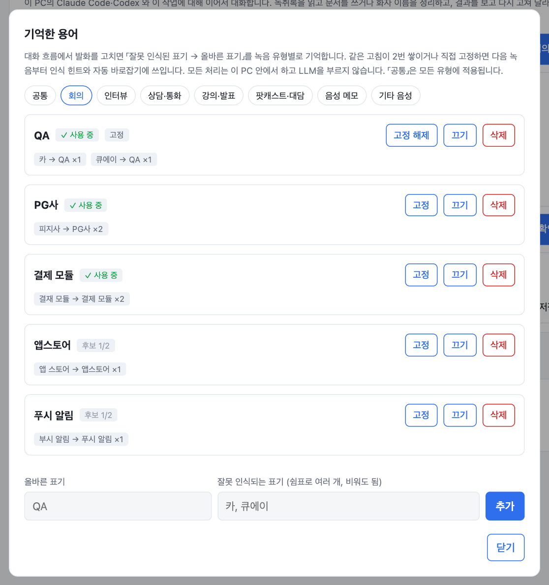

- 쓰이는 곳: 올바른 표기를 Whisper 인식 힌트(`initial_prompt`)와 보정·문서 프롬프트에 넣고, 새 녹취록에서 잘못된 표기를 단어 단위로 바로잡습니다. "카를"은 "QA를"이 되고 "카페"나 "자카르타"는 그대로 둡니다.
- 한 글자 표기는 오작동 위험이 커서 고정해야 자동으로 바꿉니다. 한 번에 여러 단어를 다시 쓴 큰 수정은 학습하지 않습니다.
- 유형별 사전과 모든 유형에 적용되는 「공통」 사전이 있고, 목록에서 고정, 끄기, 삭제, 직접 추가를 할 수 있습니다.
- LLM 호출 없이 이 PC 안에서만 동작합니다. 녹음을 올릴 때 「기억한 용어 사용」으로 끌 수 있고, 파일은 `~/.config/voicekit/memory/<유형>.json`(`VOICEKIT_MEMORY_DIR`)입니다. `VOICEKIT_MEMORY=off`면 전부 무시합니다. 고친 이력은 작업 폴더의 `edits.json`, 자동으로 바꾼 곳은 `memory_applied.json`에 남습니다.

### 녹취록 보정

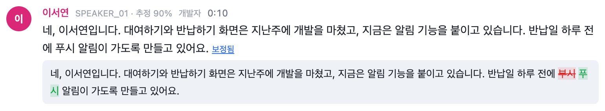

회의록을 쓰기 전에 LLM이 앞뒤 맥락, 이름 후보, 용어로 인식 오류만 고칩니다 ("부시 알림" → "푸시 알림"). 화자와 시각은 그대로 두고, 요약이나 추가로 보이는 큰 수정은 코드에서 거절합니다. 턴마다 원문과 단어 단위로 비교할 수 있습니다.

### 문서

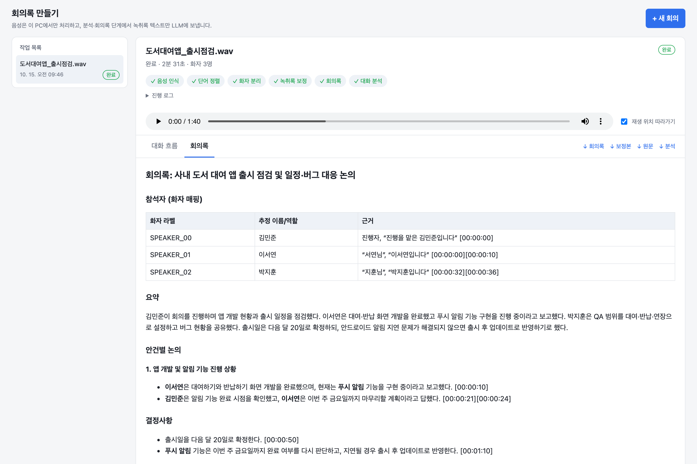

참석자 매핑, 요약, 안건별 논의, 결정사항, 액션 아이템, 미결 사항을 모든 항목의 근거 시각과 함께 정리합니다. 모델이나 이름 후보를 바꿔 다시 만들 수 있고, 에이전트가 쓴 문서를 붙여 넣어 채울 수도 있습니다. 작업은 머리의 「삭제」로 작업 폴더째 지웁니다.

### 에이전트에게 시키기

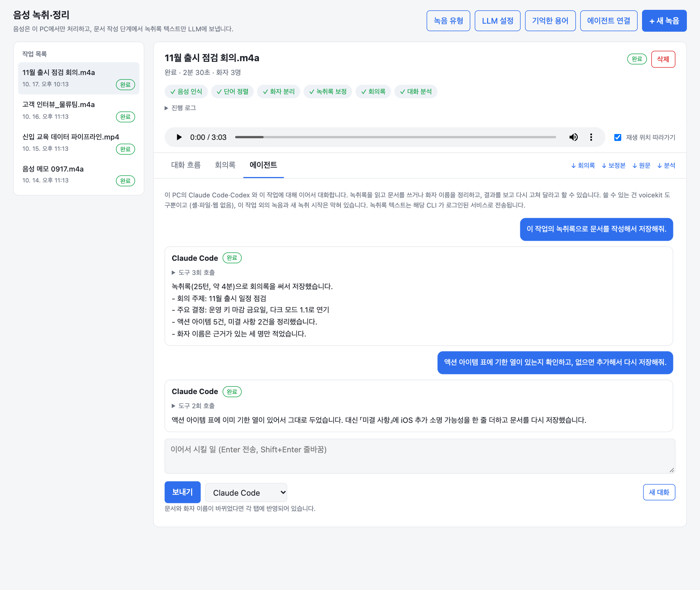

작업의 「에이전트」 탭에서 이 PC의 Claude Code나 Codex와 **이어서 대화**합니다. 「문서 작성」「화자 이름 확정」「결정·할 일만」 같은 예시로 시작하고, 결과를 보고 「두번째 안건만 더 자세히」처럼 계속 고쳐 달라고 할 수 있습니다. 도구 호출이 한 줄씩 보이고, 이전 대화는 작업 폴더에 남으며 「새 대화」로 지웁니다.

- 에이전트가 쓸 수 있는 것은 voicekit 도구뿐입니다. 셸, 파일, 웹은 없고, 이 작업 하나만 다룰 수 있어 다른 녹음을 읽거나 새 녹취를 시작하거나 다른 모델을 호출하지 못합니다.
- 한 번에 한 작업만 돌고 중간에 중단할 수 있으며, 전역 연결 없이 CLI만 있으면 동작합니다.

### LLM 설정

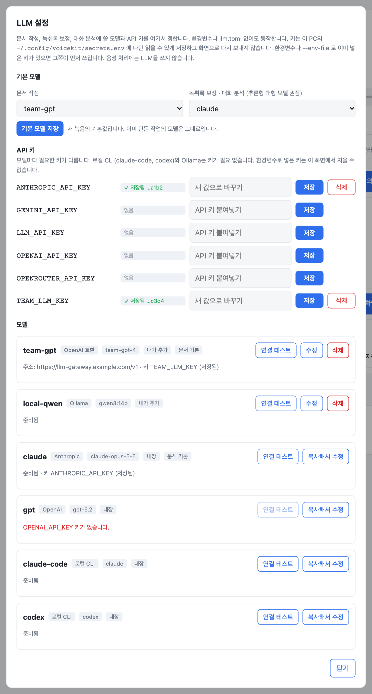

- **기본 모델**: 문서 작성용과 보정·분석용을 따로 고릅니다. 새 녹음의 기본값이 됩니다.
- **API 키**: 키를 붙여넣고 저장하면 이 PC의 `~/.config/voicekit/secrets.env`에 나만 읽을 수 있게(0600) 저장합니다. 화면으로 다시 보내지 않고 끝 4자리만 보여줍니다. 환경변수나 `--env-file`로 이미 넣은 키가 있으면 그쪽이 먼저 쓰입니다.
- **모델**: 사내 게이트웨이나 vLLM, Ollama를 이름과 주소, 모델 id로 추가하고 「연결 테스트」로 키와 주소가 맞는지 바로 확인합니다. 키가 없거나 주소가 빠진 모델은 이유가 표시됩니다.
- 모델 목록은 `~/.config/voicekit/llm.toml`에 저장되고, 프로젝트의 `llm.toml`과 합쳐집니다 (같은 이름이면 화면에서 저장한 쪽이 이깁니다).

### 에이전트 연결

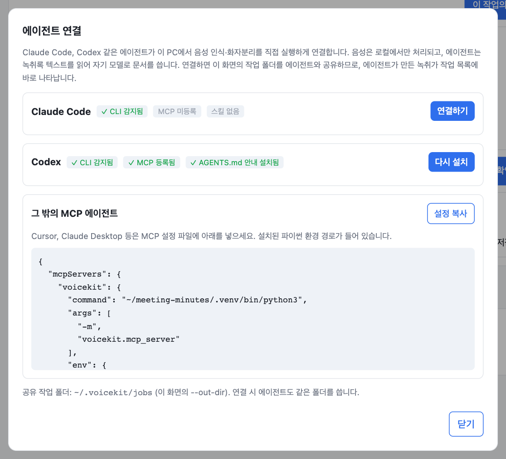

Claude Code·Codex의 CLI 감지, MCP 등록, 스킬 설치 상태를 보고 버튼으로 연결합니다. 사용자 전역 설정을 바꾸므로 실행 전에 할 일을 보여주고 확인을 받습니다. 연결하면 이 화면의 작업 폴더(`--out-dir`)를 에이전트가 같이 쓰므로, 에이전트가 만든 녹취가 작업 목록에 나타나고 진행도 따라갑니다. 다른 MCP 에이전트용 설정 JSON도 복사할 수 있습니다.

### 녹음 유형

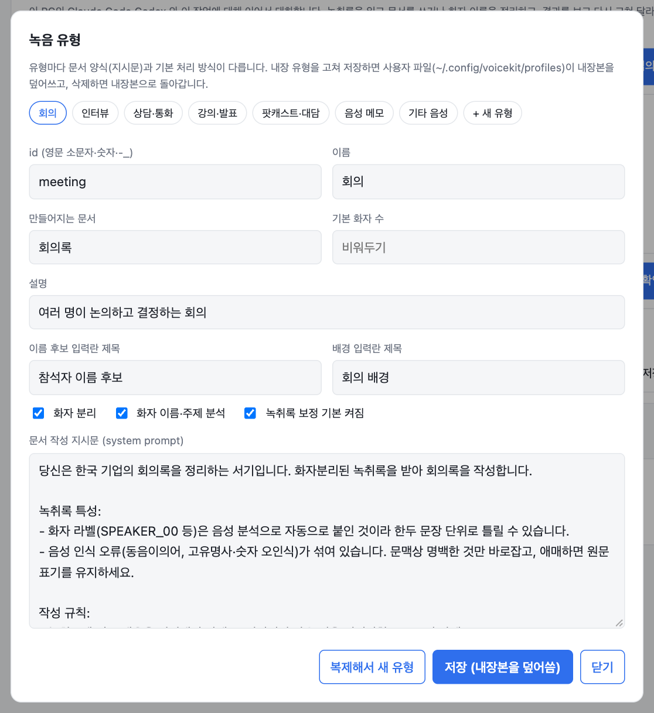

유형 보기, 새 유형 추가, 복제, 수정, 삭제를 화면에서 합니다. 저장하면 `~/.config/voicekit/profiles/<id>.toml`이 생깁니다. 내장 유형을 고쳐 저장하면 사용자 파일이 내장본을 덮어쓰고, 삭제하면 내장본으로 돌아갑니다.

> [!WARNING]
> 웹 서버에는 인증이 없습니다. 기본값처럼 `127.0.0.1`에만 열어 두고, `--host 0.0.0.0`으로 다른 사람에게 열지 마세요. 에이전트 설치·프로필 저장·키 저장·작업 삭제 같은 변경 요청은 다른 사이트에서 온 것이면 거절합니다.

산출물은 `out/web/<작업 id>/`에 쌓이고, 서버를 다시 켜면 이 폴더에서 작업 목록을 다시 읽습니다.

## LLM 연결

가장 쉬운 방법은 화면의 「LLM 설정」입니다. 파일과 환경변수로도 같은 설정을 할 수 있고, CLI의 `--llm`에는 별칭이나 `제공자:모델`을 넘깁니다.

| 값 | 연결 대상 | 필요한 키 |
|---|---|---|
| `claude` (기본) | `anthropic:claude-opus-5-5` | `ANTHROPIC_API_KEY` |
| `gpt` | `openai:gpt-5.2` | `OPENAI_API_KEY` |
| `claude-code`, `codex` | 이 PC에 로그인된 CLI에 넘김 | 없음 |
| `anthropic:<모델>` | Anthropic API | `ANTHROPIC_API_KEY` |
| `openai:<모델>` | OpenAI (`OPENAI_BASE_URL`로 Azure·프록시) | `OPENAI_API_KEY` |
| `gemini:<모델>` | Gemini OpenAI 호환 엔드포인트 | `GEMINI_API_KEY` |
| `openrouter:<모델>` | OpenRouter | `OPENROUTER_API_KEY` |
| `ollama:<모델>` | 로컬 Ollama (`OLLAMA_BASE_URL`, 기본 `http://localhost:11434/v1`) | 없음 |
| `compat:<모델>` | 그 밖의 OpenAI 호환 서버 (`LLM_BASE_URL`) | `LLM_API_KEY` (선택) |

**키를 읽는 순서**: 환경변수, `--env-file`, 화면에서 저장한 `secrets.env` 순입니다. 그래서 이미 export해 둔 키는 계속 동작합니다.

<details>
<summary>파일로 설정하기 (환경변수, llm.toml)</summary>

키는 환경변수나 `--env-file .env`로 넣습니다. [.env.example](.env.example)을 복사해서 쓰세요.

자주 쓰는 모델에 이름을 붙이거나 기본값을 바꾸려면 `llm.toml`을 만듭니다 ([llm.example.toml](llm.example.toml)). 사내 게이트웨이처럼 주소와 키 이름이 정해진 엔드포인트를 코드 수정 없이 붙일 때 씁니다. `llm.toml`은 gitignore 되어 있습니다.

```toml
default = "local"
analysis_default = "smart"

[models.local]
provider = "ollama"
model = "qwen3:14b"

[models.smart]
provider = "openai"
model = "gpt-5.2"

[models.team]
provider = "compat"
base_url = "https://llm-gateway.example.com/v1"
model = "team-model-id"
api_key_env = "TEAM_LLM_KEY"
```

설정 위치와 우선순위: 프로젝트의 `llm.toml`(또는 `--llm-config`) 위에 화면에서 저장한 `~/.config/voicekit/llm.toml`(`VOICEKIT_CONFIG_DIR`)이 겹쳐집니다.
</details>

**모델 고르기**: 녹취록 보정과 화자 이름 추정은 "근거 없으면 고치지 말 것", "발화 속 제3자를 화자로 착각하지 말 것" 같은 규칙을 지켜야 해서, 추론형 대형 모델(Claude, GPT-5 급)에서 결과가 가장 좋았습니다. 작은 모델은 없는 화자 라벨을 만들거나 담당자를 잘못 붙이는 경우가 있었습니다. 회의록만 작은 모델로 쓰고 분석은 큰 모델로 나누는 구성(`default` / `analysis_default`)을 권장합니다.

## 에이전트와 함께 쓰기

음성 인식, 단어 정렬, 화자 분리는 LLM이 필요 없으니 에이전트가 로컬 도구로 호출하고, 문서 작성은 에이전트가 자기 모델로 합니다. 연결은 화면의 「에이전트 연결」이나 아래 CLI로 합니다.

```bash
uv sync --extra mcp
uv run voicekit install claude            # 할 일만 출력 (dry run)
uv run voicekit install claude --apply    # 스킬(~/.claude/skills/voicekit) + MCP 서버 등록
uv run voicekit install codex --apply     # ~/.codex/AGENTS.md에 안내 블록 + MCP 서버 등록
```

수동으로 등록하려면 `claude mcp add voicekit -- <이 저장소 .venv>/bin/python -m voicekit.mcp_server` (Codex는 `codex mcp add ...`).

| MCP 도구 | 하는 일 |
|---|---|
| `list_profiles` | 녹음 유형 목록 |
| `transcribe_audio` | 로컬 녹취 시작 (ASR + 단어 정렬 + 화자 분리), `job_id` 즉시 반환 |
| `wait_for_job`, `job_status`, `list_jobs` | 진행 확인. 한 번에 최대 약 50초 대기 |
| `read_transcript` | 녹취록을 페이지로 읽기 (`next_offset`) |
| `get_document_prompt` | 프로필 양식의 system·user 프롬프트. 에이전트가 이걸로 직접 문서 작성 |
| `save_document` | 작성한 문서를 작업에 저장 (웹 화면에 같이 보임) |
| `generate_document` | 다른 모델(`claude-code`, `codex`, 별칭, `provider:model`)이 대신 작성 |
| `set_speaker_names` | 화자 라벨에 이름 확정 |

MCP 없이도 같은 흐름을 CLI로 쓸 수 있습니다 (스킬이 두 경로를 모두 안내합니다).

```bash
uv run voicekit transcribe meeting.m4a --profile interview --speakers 2 --vocab "QA,결제 모듈"
uv run voicekit prompt <job> --names "김기자,박교수"      # 에이전트가 따라 쓸 프롬프트
uv run voicekit save-document <job> < document.md
```

작업 폴더는 기본 `~/.voicekit/jobs`입니다. 웹 화면에서 에이전트가 만든 작업을 보려면 같은 폴더를 가리키세요: `uv run meeting-minutes-web --out-dir ~/.voicekit/jobs`.

### Claude Code, Codex에 문서 작성 맡기기

모델 이름 `claude-code`, `codex` (또는 `cli:claude:opus`, `cli:codex:gpt-5.2`)를 고르면 로컬에 로그인된 CLI에 프롬프트를 넘겨 문서를 받아옵니다. API 키가 필요 없고, 웹 화면의 모델 목록과 `--llm`에서 그대로 쓸 수 있습니다.

```bash
uv run meeting-minutes meeting.m4a --llm claude-code
uv run voicekit handoff <job> --agent codex        # 이미 만든 녹취록에서 문서만
```

에이전트는 빈 임시 폴더에서 도구를 끈 채(Claude는 `--tools ""`, Codex는 `read-only` 샌드박스) 실행되어 프롬프트만 읽고 답합니다. 음성이나 작업 폴더는 보지 못합니다.

## CLI

```bash
# 기본
uv run meeting-minutes meeting.m4a

# 화자 수, 참석자, 용어를 알려주면 정확도가 오릅니다
uv run meeting-minutes meeting.m4a --speakers 3 \
  --names "김팀장,이선임,박매니저" \
  --vocab "QA,결제 모듈" \
  --context "11월 출시 일정 점검 회의" \
  --correct --analyze

# 완전 로컬
uv run meeting-minutes meeting.m4a --llm ollama:qwen3:14b --analysis-llm ollama:qwen3:14b

# 녹취록만 (LLM 호출 없음)
uv run meeting-minutes meeting.m4a --no-summary

# STT 없이 회의록만 다시 생성 (transcript.json을 손으로 고친 뒤에도)
uv run meeting-minutes out/meeting/transcript.json --llm gpt
```

<details>
<summary>옵션 전체</summary>

| 옵션 | 설명 |
|---|---|
| `--speakers N` | 화자 수를 알면 지정. 화자 분리 정확도에 가장 큰 영향 |
| `--min-speakers` / `--max-speakers` | 범위만 아는 경우 |
| `--vocab` | 고유명사·약어. Whisper initial prompt와 LLM 단계 둘 다에 들어감 |
| `--names` | 화자 라벨을 이름으로 매핑할 때 쓰는 후보. 근거가 약하면 매핑하지 않음 |
| `--context` | 회의 배경 한두 줄 |
| `--profile` | 녹음 유형 (아래 표) |
| `--no-diarize` | 한 명이 말하는 녹음은 화자 분리를 건너뜀 (훨씬 빠름) |
| `--llm` | 문서 모델 (위 표) |
| `--analysis-llm` | `--correct`, `--analyze`에 쓸 모델 |
| `--llm-config` | `llm.toml` 경로 (기본: 현재 폴더) |
| `--env-file` | API 키가 든 env 파일. 환경변수가 우선 |
| `--correct` | 회의록 전에 녹취록 보정, `transcript_corrected.{json,md}` 저장 |
| `--analyze` | 화자 이름 확률, 주제 구간, 핵심 발화를 `analysis.json`으로 저장 |
| `--asr-model` | 기본 `large-v3-turbo`. 정확도 우선이면 `large-v3` (약 2배 느림) |
| `--language` | 기본 `ko`. `auto`면 자동 감지 |
| `--diarize-device mps` | pyannote를 Apple GPU로 (미측정, 불안정하면 기본값 `cpu`) |
</details>

## 녹음 유형 (프로필)

| id | 용도 | 문서 | 화자 분리 |
|---|---|---|---|
| `meeting` | 여러 명이 논의·결정하는 회의 | 회의록 | O |
| `interview` | 인터뷰, 취재, 면담 | 인터뷰 정리 | O |
| `call` | 고객 상담, 콜센터, 영업 통화 | 상담 요약 (개인정보 가림) | O |
| `lecture` | 강의, 발표, 세미나 | 강의 노트 | X (빠름) |
| `podcast` | 팟캐스트, 대담, 라디오 | 에피소드 노트 | O |
| `memo` | 혼자 말로 남기는 메모 | 메모 정리 | X (빠름) |
| `general` | 유형을 모를 때 | 음성 요약 | O |

웹 화면은 업로드할 때 유형을 고르고, CLI는 `--profile interview`, 한 명만 말하는 녹음은 `--no-diarize`로 화자 분리를 건너뜁니다. 음성 언어는 웹 화면 또는 `--language`로 고르고, 단어 정렬 모델이 없는 언어는 문장 단위 시각으로 화자를 붙입니다.

직접 만들려면 화면의 「녹음 유형」이나 TOML 한 개면 됩니다. `./profiles/`, `~/.config/voicekit/profiles/`, `$VOICEKIT_PROFILES` 중 한 곳에 두면 같은 id의 내장 프로필보다 우선합니다.

```toml
# profiles/sales-call.toml
label = "영업 통화"
document = "영업 통화 노트"
description = "고객과 하는 영업 통화"
diarize = true
analysis = false          # 대화 분석(화자 이름 확률, 주제 구간) 생략
system_file = "sales-call.md"   # 또는 system = """...""" 로 직접
```

내장 양식은 [voicekit/profiles/](voicekit/profiles/)를 보세요.

## 데이터가 어디로 가나요

- 음성 파일은 PC 밖으로 나가지 않습니다 (MCP 서버가 읽어 주는 것도 텍스트뿐). 모델 가중치만 처음에 Hugging Face에서 받습니다.
- 고른 LLM 제공자에게는 **녹취록 텍스트**가 전송됩니다. `claude-code`, `codex`를 고르면 그 CLI가 연결된 서비스로, MCP로 붙인 에이전트는 그 에이전트의 모델로 갑니다. 민감한 회의라면 `ollama:`나 사내 서버를 쓰거나 `--no-summary`로 녹취록만 만드세요.
- 화면에서 저장한 API 키는 `~/.config/voicekit/secrets.env`(권한 0600)에만 있고 브라우저로 다시 나오지 않습니다. 기억한 용어와 에이전트 대화는 각각 `~/.config/voicekit/memory/`와 작업 폴더에 평문으로 저장됩니다.
- 웹 화면은 marked, DOMPurify를 cdnjs에서 불러옵니다 (회의 데이터는 보내지 않음).

## 성능 (Apple M4 Pro, CPU)

| 입력 | 음성 인식 | 단어 정렬 | 화자 분리 |
|---|---|---|---|
| 7분 회의, 3명 | 108s | 24s | 315s |
| 24분 회의, 5명 | 493s | 68s | 1063s |

화자 분리가 병목이고 음성 길이의 약 0.7배가 걸립니다. LLM 단계(보정, 분석, 회의록)는 모델에 따라 수십 초입니다. CTranslate2에 MPS 백엔드가 없어서 음성 인식은 Apple Silicon에서도 CPU로 돕니다.

## 개발

```bash
uv run --group dev pytest       # 모델·네트워크 없이 도는 테스트
uvx ruff check .
```

## 라이선스

[MIT](LICENSE). 사용하는 모델은 각자의 라이선스를 따릅니다: [WhisperX](https://github.com/m-bain/whisperX) (BSD-2-Clause), [faster-whisper](https://github.com/SYSTRAN/faster-whisper) (MIT), [pyannote speaker-diarization-community-1](https://huggingface.co/pyannote/speaker-diarization-community-1) (CC-BY-4.0, 사용 동의 필요), [wav2vec2-large-xlsr-korean](https://huggingface.co/kresnik/wav2vec2-large-xlsr-korean) (Apache-2.0).
