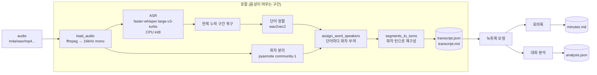
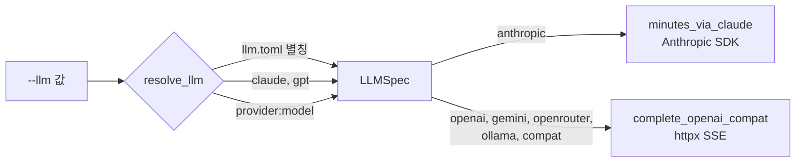
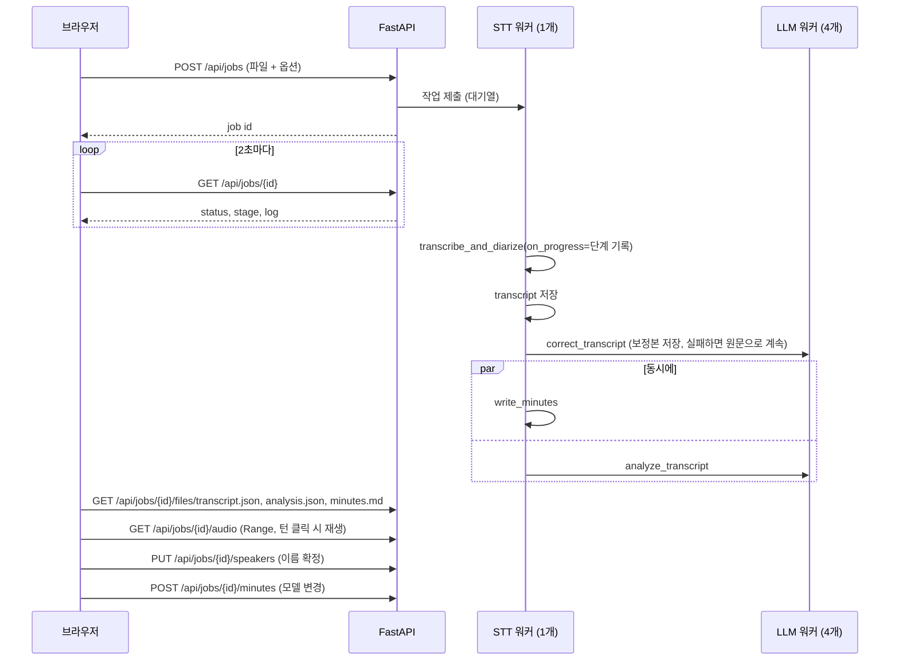

# meeting-minutes 아키텍처

음성 파일 하나를 받아 화자별 녹취록과 회의록을 만드는 로컬 도구. 사용법은 [README](../README.md), 이 문서는 구조와 설계 이유, 참고 자료를 정리한다.

## 1. 배경

온디바이스 Whisper로 받아쓰고 LLM으로 요약하는 서비스는 많지만, 화자 분리가 없으면 "누가 무슨 말을 했는지", "누가 담당인지"가 회의록에 남지 않는다.

이 도구는 같은 방향(음성은 로컬, LLM에는 텍스트만)을 유지하면서 화자 분리를 더했다.

| 항목 | 일반적인 온디바이스 요약 | meeting-minutes |
|---|---|---|
| STT | 온디바이스 Whisper | 로컬 faster-whisper (WhisperX) |
| 단어 타임스탬프 | - | wav2vec2 강제 정렬 |
| 화자 분리 | 없음 | pyannote community-1 |
| 요약 LLM | 정해진 클라우드 LLM | Claude, OpenAI 호환 서버 아무거나, 로컬 Ollama |
| 외부로 나가는 데이터 | 텍스트 | 텍스트 (녹취록만), Ollama면 없음 |

## 2. 전체 흐름



진입점은 CLI(`meeting-minutes`)와 로컬 웹 화면(`meeting-minutes-web`) 두 개이고, 같은 함수를 쓴다. 입력 경로는 두 갈래다.

- **오디오 입력**: STT부터 회의록까지 전체 실행. 결과를 `out/<파일명>/`에 저장한다.
- **`transcript.json` 입력**: STT를 건너뛰고 저장된 턴으로 회의록만 다시 만든다. 이름 후보나 모델을 바꿔 재생성하거나, 녹취록을 손으로 고친 뒤 다시 돌릴 때 쓴다.

## 3. 단계별 설명

### 3.1 ASR: faster-whisper

- 모델: `large-v3-turbo` (실제 가중치는 `mobiuslabsgmbh/faster-whisper-large-v3-turbo`, CTranslate2 변환본)
- WhisperX가 VAD로 음성 구간을 자른 뒤 배치로 받아쓴다.
- **CPU int8 고정**: CTranslate2에는 Apple MPS 백엔드가 없다. M 시리즈에서는 CPU int8이 가장 빠르다.
- `--vocab` 값은 Whisper `initial_prompt`로 넘어간다. 고유명사 표기를 유도하는 용도인데, 실측에서는 효과가 들쭉날쭉했다.

**반복 인식(hallucination) 복구**: Whisper 디코더는 조용하거나 애매한 구간에서 같은 토큰을 끝없이 반복하는 고장이 있다("Q. Q. Q. ...", 같은 문장 8번, "독독독독..."). 원래 Whisper와 faster-whisper의 비배치 모드는 압축률(> 2.4)로 이걸 잡아 temperature를 올려 다시 디코딩한다. 그런데 WhisperX의 배치 디코딩(`generate_segment_batched`)에는 이 fallback이 없어서 고장 난 결과가 그대로 나오고, 그 밑의 실제 발화는 사라진다. 실제로 24분 회의에서 18초 구간이 "Q" 200여 개로 채워졌는데, 같은 구간만 잘라 다시 받아쓰니 정상 문장이 나왔다. 배치 디코딩은 실행마다 결과가 달라서, 반복이 생기는 위치도 매번 바뀐다.

그래서 `_repair_segments`가 ASR 직후 세그먼트마다 반복을 찾는다(1~5단어 단위가 연속 반복, 한 단어면 5회 이상, 문구면 4회 이상, 글자 6회 이상 반복, 또는 압축률 2.4 초과). 걸리면 그 구간 오디오만 faster-whisper 비배치 모드(temperature fallback 포함)로 다시 디코딩한다. 그래도 반복되면 `collapse_repeats`가 반복을 걷어낸다. 한 단어 반복은 `[인식 불가]`로 바꾸고, 문구 반복은 첫 번째 것만 남긴다.

**건너뛴 발화 복구**: 배치 디코딩은 반복 없이 구간 앞부분을 통째로 건너뛰고 마지막 한두 문장만 내기도 한다. 합성 3인 회의에서 18초 구간이 글자 30개(초당 1.7자)로만 나왔고, 한 사람의 보고 발화 전체가 사라졌다. 더 나쁜 건 그다음이다. wav2vec2 정렬이 남은 문장을 구간 맨 앞, 즉 사라진 화자의 목소리 위치에 붙여서 다른 사람의 질문이 그 화자의 말로 기록됐다. 같은 구간을 비배치 모드로 다시 받아쓰면 전부 나왔다.

정상 발화는 한국어 기준 초당 5~8자(공백 제외)라서, 8초 이상인데 초당 2.5자에 못 미치는 세그먼트도 같은 방식으로 다시 디코딩한다(`is_sparse_segment`). 실제로 말이 드문 구간일 수도 있으니, 다시 받아쓴 결과가 원래보다 길고 반복이 없을 때만 바꾼다.

### 3.2 단어 정렬: wav2vec2

Whisper가 주는 타임스탬프는 세그먼트 단위라 화자를 단어 단위로 붙이기에 부족하다. WhisperX는 언어별 wav2vec2 CTC 모델로 강제 정렬을 해서 단어마다 start/end를 붙인다. 한국어는 `kresnik/wav2vec2-large-xlsr-korean`.

숫자나 기호처럼 정렬이 안 되는 단어는 타임스탬프 없이 남는다. 이 처리는 3.5에서 다룬다.

### 3.3 화자 분리: pyannote community-1

- 모델: `pyannote/speaker-diarization-community-1` (WhisperX 3.8 기본값, HF gated)
- 출력은 `(start, end, speaker)` 구간 표다.
- `--speakers N`을 주면 클러스터 수를 고정한다. 화자 수를 알면 정확도가 가장 크게 오른다.
- 장치 기본값은 CPU. `--diarize-device mps`로 Apple GPU를 쓸 수 있지만 아직 실측하지 않았다.

### 3.4 단어-화자 결합

`whisperx.diarize.assign_word_speakers`가 단어 구간과 화자 구간의 겹침을 보고 단어와 세그먼트에 `speaker`를 붙인다.

### 3.5 턴 재구성 (`segments_to_turns`)

Whisper 세그먼트 하나에 두 사람 말이 섞이는 경우가 흔하다. 세그먼트 단위 화자를 그대로 쓰면 "A가 한 말 + B의 대답"이 A의 발화로 묶인다. 그래서 두 단계로 다시 만든다.

1. **쪼개기**: 세그먼트 안에서 단어 화자가 바뀌는 지점마다 자른다. 타임스탬프가 없는 단어는 직전 화자를 이어받는다.
2. **합치기**: 같은 화자의 조각이 2초(`max_gap`) 이내로 이어지면 한 턴으로 합친다.

결과는 `Turn(speaker, start, end, text)` 리스트이고, 이게 이후 모든 단계의 입력이다.

### 3.6 녹취록 보정 (`correct_transcript`)

회의록·분석 전에 LLM이 녹취록의 인식 오류만 고친다.

- 입력: 턴 번호를 붙인 녹취록을 약 3,000자 단위로 나누고, 각 조각 앞뒤로 2턴씩 `<context>`를 붙인다. 고칠 대상은 `<target>` 안의 턴뿐이다. 이름 후보·용어·회의 배경도 함께 넣는다. 조각들은 동시에 4개까지 돌린다(24분 회의 약 9초).
- 출력: 바뀐 턴만 `{"turns": [{"turn": n, "text": ...}]}`로 받는다.
- 고치는 것: 발음이 비슷한 오인식, 고유명사·용어 표기 통일, 띄어쓰기, 반복 인식. 고치지 않는 것: 요약, 말투 다듬기, 내용 추가, 알아듣기 어려운 구간 추측, 화자·순서.
- 코드 검증: 대상 조각 밖 턴 수정은 버린다. 길이가 원문의 0.6배 미만이거나 1.5배를 넘으면 요약이나 추가로 보고 거절한다(반복이 있던 턴은 줄어드는 게 정상이라 예외). 반복은 LLM에 보내기 전에 코드에서 먼저 걷어낸다.
- 저장: `transcript.json`(원문)은 그대로 두고 `transcript_corrected.json`에 보정본과 턴별 `original`/`corrected`/`rejected`를 남긴다. 화면이 이걸로 단어 단위 비교를 보여준다.
- 이후 회의록·분석·이름 확정 검증은 보정본을 쓴다. 화자와 시각은 원문과 같다.

실측에서는 대부분 맞게 고쳤지만, 발음이 전혀 다른 말로 바꾸는 추측성 수정이 한 번 나왔다. 그래서 "알아듣기 어려운 구간을 추측해서 채우지 말 것" 규칙을 넣었다. LLM 결과는 실행마다 조금씩 달라서, 보정본은 원문과 비교해 볼 수 있게 했다.

### 3.7 회의록 생성

프롬프트는 시스템 프롬프트(`MINUTES_SYSTEM`)와 사용자 프롬프트 두 부분이다.

**시스템 프롬프트의 핵심 규칙**

- 녹취록에 실제로 나오는 화자 라벨만 쓴다 (없는 `SPEAKER_03`을 만드는 문제 대응)
- 화자 이름은 스스로 밝히거나, 이름이 불린 직후 그 화자가 답했을 때만 붙인다. 발화 속에 나온 제3자를 화자로 착각하지 않는다. 근거가 없으면 "미상"
- 담당자는 "제가 하겠다"고 말한 화자
- 모든 항목에 `[HH:MM:SS]` 근거
- 출력 순서 고정: 참석자 표 → 요약 → 안건별 논의 → 결정사항 → 액션 아이템 → 미결 사항

**사용자 프롬프트 (`build_user_prompt`)**

```
녹취록의 화자 라벨 (3개): SPEAKER_00, SPEAKER_01, SPEAKER_02
사용자가 확인한 화자 이름: ...   (화면에서 확정한 이름)
참석자 이름 후보: ...            (--names)
회의 배경: ...                   (--context)
용어 목록: ...                   (--vocab, ASR 오인식 교정 지시 포함)

<transcript>
# 화자별 녹취록
**[00:00:04] SPEAKER_00**: ...
</transcript>
```

라벨 목록을 맨 앞에 두는 이유는 모델이 존재하는 라벨 범위를 먼저 알게 하려는 것이다.

### 3.8 대화 분석 (`analyze_transcript`)

대화 흐름 화면을 위한 구조 정보를 LLM 한 번 호출로 받는다.

입력은 턴마다 번호를 붙인 녹취록(`#12 [00:03:41] SPEAKER_01: ...`)이고, 출력은 JSON 하나다.

| 항목 | 내용 |
|---|---|
| `speakers` | 라벨별 이름 후보와 확률(합 1), 후보별 근거 턴 번호·이유, 대화 속 역할 |
| `topics` | 주제 구간 2~8개: 시작 턴, 제목, 한 문장 요약 |
| `key_turns` | 결정 / 할 일 / 질문 / 이슈로 표시할 턴 |

**확률의 의미**: 목소리를 비교한 값이 아니라, LLM이 대화 문맥(자기소개, 호명 후 응답, 역할 언급)을 보고 매긴 주관적 확신도다. 근거가 약하면 "미상"에 큰 확률을 주도록 지시했다. 참석자 이름 후보를 주면 그 안에서만 고른다.

**근거를 턴 번호로 받는 이유**: 회의록 단계에서 LLM이 없는 타임스탬프를 인용하는 문제가 있었다. 턴 번호로 받으면 `normalize_analysis`에서 검증할 수 있다.

`normalize_analysis`가 응답에서 걸러내는 것:
- 녹취록에 없는 라벨, 범위 밖 턴 번호, 정해진 4종이 아닌 핵심 턴 유형
- 확률은 0 이상으로 자르고 라벨별 합이 1이 되게 다시 나눔. 같은 이름 후보가 두 번 나오면 합침
- 빠진 라벨은 "미상 100%"로 채움
- 주제는 시작 턴 기준으로 정렬하고 중복을 없앤 뒤, 첫 구간을 #0부터 시작하게 늘려서 모든 턴이 어느 주제엔가 속하게 함

## 4. LLM 연결

모든 LLM 호출은 `_complete(user, system, llm, env_file)` 하나를 거친다. `llm` 문자열을 `resolve_llm`이 `LLMSpec(provider, model, base_url, api_key_env, reasoning)`으로 바꾸고, 제공자에 따라 두 클라이언트 중 하나로 보낸다.



### 4.1 이름 해석 순서

1. `llm.toml`의 `[models.<이름>]`
2. 내장 별칭: `claude` → `anthropic:claude-opus-5-5`, `gpt` → `openai:gpt-5.2`
3. `provider:model` 형식. 모델 id 안의 콜론은 그대로 둔다(`ollama:qwen3:14b`).

기본 모델은 `llm.toml`의 `default`(회의록)와 `analysis_default`(보정·분석)이고, 없으면 `claude`. 설정 파일의 기본값이 해석되지 않으면 시작할 때 바로 실패한다.

`llm.toml`을 둔 이유는 사내 게이트웨이처럼 주소와 키 이름이 정해진 엔드포인트를 코드에 넣지 않기 위해서다. 공개 코드에는 일반 제공자만 있고, 설치마다 다른 설정은 gitignore된 파일에 남는다.

### 4.2 OpenAI 호환 클라이언트 (`complete_openai_compat`)

OpenAI, Gemini, OpenRouter, Ollama, vLLM, 사내 게이트웨이를 한 코드로 부른다. 실제 게이트웨이들에서 마주친 차이를 이렇게 흡수한다.

| 서버 쪽 동작 | 코드 대응 |
|---|---|
| `stream: false`를 거부하는 서버가 있음 | 항상 SSE로 받아 `delta.content`를 이어 붙임. 긴 회의록에서 프록시 타임아웃도 피함 |
| SSE 줄이 `data:{...}` (콜론 뒤 공백 없음) | `line[5:].strip()`으로 파싱 |
| 미등록 model id에 200 + 빈 본문 | 빈 응답이면 예외 |
| 오류가 `choices` 없는 청크로 스트림 중간에 옴 (`error` 또는 `state` 필드) | 그런 청크를 만나면 예외 |
| 추론 모델(gpt-5.x, o 시리즈)은 `max_tokens`, `temperature` 거부 | `reasoning`이면 `max_completion_tokens`만 보냄. 추론 토큰도 이 한도에 포함돼서 넉넉하게 잡음. `openai` 제공자는 기본 `reasoning=true` |
| `base_url`이 `/v1` 기준이거나 전체 엔드포인트 | `/chat/completions`로 끝나지 않으면 붙임 |
| `finish_reason=length` | 잘림 경고 로그 |

- 키 탐색 순서: 환경변수 → `--env-file`. 코드에 키를 두지 않는다.
- 키가 필요 없는 건 `ollama`와 키를 지정하지 않은 `compat`뿐이다. 나머지는 키가 없으면 어느 변수가 필요한지 알려주고 멈춘다.

### 4.3 Claude (`minutes_via_claude`)

Anthropic SDK, 기본 모델 `claude-opus-5-5`, effort `medium`, streaming 후 `get_final_message()`. 안전 사유로 거절되면 서버 쪽에서 fallback 모델로 다시 돌리도록 `server-side-fallback-2026-07-01` beta와 `fallbacks="default"`를 켰다.

### 4.4 모델 선택

보정과 화자 이름 추정은 "근거 없으면 고치지 말 것", "제3자를 화자로 착각하지 말 것" 같은 규칙을 지켜야 한다. 같은 프롬프트로 7분 회의를 비교했을 때 소형 모델은 없는 화자 라벨을 만들고, 발화 속 제3자를 화자로 매핑하고, 액션 담당자를 잘못 붙였다. 추론형 대형 모델은 근거가 없으면 "미상"으로 두었다. 그래서 회의록과 보정·분석 모델을 따로 지정할 수 있게 했다.

## 5. 웹 화면

`meeting_minutes_web.py`(FastAPI) + `web/index.html`(빌드 없는 HTML 한 장).



| 엔드포인트 | 설명 |
|---|---|
| `GET /` | 화면 |
| `GET /api/config` | 모델 목록(`llm.toml` 별칭 + 내장 별칭), 기본 모델, 분석 모델 |
| `GET /api/jobs` | 작업 목록 (최신순) |
| `POST /api/jobs` | 업로드 + 작업 시작. form: `file`, `speakers`, `names`, `context`, `vocab`, `llm`, `correct`(기본 true) |
| `GET /api/jobs/{id}` | 상태 폴링 |
| `POST /api/jobs/{id}/minutes` | 회의록만 재생성. form: `llm`, `names`, `context` |
| `POST /api/jobs/{id}/correction` | 녹취록 보정을 다시 하고 이어서 대화 분석도 다시 |
| `POST /api/jobs/{id}/analysis` | 대화 분석만 다시. form: `names` |
| `PUT /api/jobs/{id}/speakers` | 화자 이름 확정. body: `{"SPEAKER_00": "김팀장"}`, 빈 값은 확정 해제 |
| `GET /api/jobs/{id}/files/{name}` | 허용 목록의 산출물만. `?download=true`면 첨부로 |
| `GET /api/jobs/{id}/audio` | 원본 음성. Range 요청(206)을 지원해서 브라우저가 원하는 위치로 바로 갈 수 있음 |

`llm` form 값은 화면 목록에 없더라도 `resolve_llm`이 해석하면 받는다(`ollama:qwen3:14b` 같은 값).

설계 판단:
- **STT 워커 1개**: ASR·화자 분리가 CPU를 다 쓰기 때문에 동시에 돌리면 둘 다 느려진다. LLM 호출은 네트워크 대기라 별도 풀(4개)에서 돌려서 긴 STT 뒤에 줄서지 않게 했다.
- **보정과 분석은 부가 기능**: 실패해도 원문으로 회의록을 계속 만들고, 화면에 실패와 재시도 버튼만 띄운다. 회의록 생성이 실패한 경우만 작업이 실패다.
- **진행 표시**: `transcribe_and_diarize`에 `on_progress` 콜백을 받게 해서 단계별 로그를 작업 상태로 남긴다. CLI는 콜백 없이 stderr로 찍는다.
- **실패 처리**: 키 누락·gated 모델처럼 `SystemExit`로 올라오는 안내 문구도 작업 오류 메시지로 화면에 보여준다. 회의록 단계에서 실패해도 녹취록은 남아서 다른 모델로 재생성할 수 있다.
- **상태 저장**: 작업 상태를 작업 폴더의 `job.json`에 남기고, 서버가 뜰 때 `out/web/*/`을 읽어 목록을 다시 만든다. 진행 중에 서버가 꺼진 작업은 "중단됨"으로 표시한다. 로컬 단일 사용자 도구라 DB는 두지 않았다.
- **보안**: 기본 바인드 `127.0.0.1`, 인증 없음. 업로드 파일은 `input.<확장자>`로만 저장하고(원래 파일명은 표시용), 파일 조회는 허용 목록과 원본 음성만 연다. 화면은 사용자 데이터를 전부 텍스트 노드로 만들고, `innerHTML`은 marked로 렌더링한 뒤 DOMPurify를 거친 회의록에만 쓴다. CDN을 못 읽으면 원문 Markdown을 그대로 보여준다.

**화면 구성**

| 영역 | 내용 |
|---|---|
| 상단 | 파일명, 단계 표시, 경과 시간, 오류, 진행 로그 |
| 플레이어 | 원본 음성. 화면 위에 고정. "재생 위치 따라가기"를 켜면 재생 중인 발화로 자동 스크롤 |
| 대화 흐름 탭 | 보정본/원문 전환, 턴별 단어 단위 비교, 화자별 타임라인 레인, 필터(화자, 핵심 발화, 검색), 주제 구간별 대화와 요약·화자 비중 막대 |
| 오른쪽 패널 | 화자 카드(발화 비중, 이름 후보 확률, 근거 발화, 이름 확정), 주제 목차, 핵심 포인트 |
| 회의록 탭 | 렌더링된 회의록, 모델·이름 후보를 바꿔 다시 만들기 |

화자 표시 이름 우선순위: 확정한 이름 → 분석 1순위 후보(미상이 아니고 50% 이상이면 "추정 NN%"와 함께) → 원래 라벨.

## 6. 코드 구조

핵심 로직은 `meeting_minutes.py` 하나에 있고, 웹은 그걸 가져다 쓰는 얇은 층이다. 무거운 의존성(whisperx, httpx, anthropic)은 쓰는 함수 안에서 import한다. 그래서 json 입력으로 회의록만 다시 만들거나 테스트를 돌릴 때는 torch를 띄우지 않는다.

| 이름 | 역할 |
|---|---|
| `_find_loops` / `is_repetition_loop` / `collapse_repeats` | 반복 인식 탐지·제거 |
| `_repair_segments` / `is_sparse_segment` | 반복되거나 발화를 건너뛴 세그먼트만 비배치 모드로 다시 디코딩 |
| `transcribe_and_diarize` | ASR → 반복·누락 복구 → 정렬 → 화자 분리 → 단어-화자 결합 |
| `segments_to_turns` | 단어 화자 기준 쪼개기 + 2초 이내 병합 |
| `build_user_prompt` / `write_minutes` | 회의록 프롬프트 조립과 호출 |
| `LLMSpec` / `configure_llms` / `resolve_llm` | 모델 이름 해석, `llm.toml` 읽기 |
| `complete_openai_compat` / `minutes_via_claude` / `_complete` | LLM 클라이언트와 분기 |
| `correct_transcript` / `build_correction_prompt` / `_accept_correction` | 녹취록 보정 |
| `analyze_transcript` / `normalize_analysis` | 대화 분석과 응답 검증 |
| `meeting_minutes_web.Job` / `JobStore` / `create_app` | 웹 작업 상태, 워커, 엔드포인트 |

```
meeting-minutes/
├── meeting_minutes.py      # 파이프라인 + LLM 연결 + CLI
├── meeting_minutes_web.py  # 로컬 웹 서버
├── web/index.html          # 화면 (HTML·CSS·JS 한 장)
├── tests/                  # STT·LLM을 스텁으로 바꾼 테스트
├── llm.example.toml        # 모델 별칭 예시 (복사해서 llm.toml)
├── .env.example            # 키 예시
├── pyproject.toml          # Python 3.12 고정, 엔트리포인트 2개
└── out/                    # gitignore, 산출물
```

### 6.1 transcript.json 형식

```json
{
  "source": "meeting.wav",
  "turns": [
    {"speaker": "SPEAKER_00", "start": 4.1, "end": 12.8, "text": "..."}
  ]
}
```

재요약 입력으로 그대로 쓰인다. `speaker`나 `text`를 손으로 고쳐도 된다.

### 6.2 의존성

| 패키지 | 용도 |
|---|---|
| whisperx 3.8 | 파이프라인 오케스트레이션 |
| faster-whisper / ctranslate2 | ASR |
| transformers | wav2vec2 정렬 |
| pyannote-audio 4 | 화자 분리 |
| torch / torchaudio | 정렬·화자 분리 런타임 |
| httpx | OpenAI 호환 호출 |
| anthropic | Claude 호출 |
| fastapi / uvicorn / python-multipart | 웹 화면 |

Python은 3.12로 고정했다. 3.14에서는 의존성 설치가 되지 않았다. 시스템에는 ffmpeg가 필요하다 (`whisperx.load_audio`가 ffmpeg로 디코딩).

## 7. 보안·데이터 경계

- 음성은 로컬에서만 처리한다. 모델 가중치만 처음 한 번 Hugging Face에서 받는다.
- LLM에는 녹취록 텍스트만 보낸다. `--no-summary`면 외부 호출이 전혀 없고, `ollama:`면 LLM 단계도 로컬이다.
- 키는 환경변수나 `--env-file`로만 읽고, 코드·산출물·로그에 남기지 않는다.
- `out/`, 음성 파일, `llm.toml`, `.env`는 gitignore. 회의 녹취록은 민감 정보일 수 있어 산출물을 저장소에 넣지 않는다.

## 8. 실측 (Apple M4 Pro, CPU)

| 입력 | ASR | 정렬 | 화자 분리 |
|---|---|---|---|
| 50초 합성 음성, 3명 | 21s | 11s | 34~41s |
| 7분 43초 회의, 3명 | 108s | 24s | 315s |
| 24분 회의, 5명 | 493s | 68s | 1063s |

병목은 CPU 화자 분리(음성 길이의 약 0.7배)다. 24분 회의에서 보정 9초, 분석 18초, 회의록 51초(GPT-5 급 모델)였다.

## 9. 알려진 한계

- **턴 경계 번짐**: 턴 끝 단어 1~2개가 다음 화자로 넘어가고, 짧은 맞장구("네 알겠습니다")가 앞 화자 턴에 흡수된다.
- **복구의 한계**: 다시 디코딩해도 반복되면 `[인식 불가]`로 남는다. 초당 2.5자보다 조금이라도 많이 남긴 부분 누락은 잡지 못한다. 그 구간은 원본 음성으로 들어야 한다(턴 클릭 재생).
- **보정은 LLM 판단**: 실행마다 결과가 조금씩 다르고, 가끔 추측성 교체가 섞인다. 원문은 항상 보존되고 화면에서 비교할 수 있다.
- **고유명사 오인식**: 같은 사람 이름이 여러 표기로 나온다. `--vocab`과 `--names`가 가장 효과적이고, 확실한 방법은 `transcript.json`을 고친 뒤 재요약이다.
- **회의록의 근거 타임스탬프는 검증 없음**: 회의록 본문이 인용한 시각은 확인하지 않는다. 대화 분석은 턴 번호로 받아 검증한다.
- **화자 확률은 문맥 추론**: 이름이 대화에 거의 안 나오는 회의에서는 모든 화자가 "미상" 60~90%로 나온다. 목소리로 맞추려면 참석자별 음성 샘플을 등록해 pyannote 임베딩과 비교하는 방식이 필요하다(미구현).
- **프롬프트와 화면은 한국어**: 다른 언어 음성도 받아쓰지만 회의록 양식은 한국어다.

후보 개선: 턴 경계 보정 휴리스틱, 회의록 인용 타임스탬프 검증, 음성 샘플 기반 화자 식별, `--diarize-device mps` 측정, 프롬프트 다국어화.

## 10. 참고 자료

**파이프라인**
- WhisperX: https://github.com/m-bain/whisperX
- WhisperX 논문 (Bain et al., 2023, *WhisperX: Time-Accurate Speech Transcription of Long-Form Audio*): https://arxiv.org/abs/2303.00747
- faster-whisper: https://github.com/SYSTRAN/faster-whisper
- CTranslate2: https://github.com/OpenNMT/CTranslate2
- Whisper large-v3-turbo (CT2 변환본): https://huggingface.co/mobiuslabsgmbh/faster-whisper-large-v3-turbo
- 한국어 정렬 모델: https://huggingface.co/kresnik/wav2vec2-large-xlsr-korean
- pyannote.audio: https://github.com/pyannote/pyannote-audio
- 화자 분리 모델: https://huggingface.co/pyannote/speaker-diarization-community-1

**LLM**
- Anthropic Messages API: https://docs.anthropic.com/en/api/messages
- OpenAI Chat Completions: https://platform.openai.com/docs/api-reference/chat
- Gemini OpenAI 호환: https://ai.google.dev/gemini-api/docs/openai
- Ollama OpenAI 호환: https://github.com/ollama/ollama/blob/main/docs/openai.md
